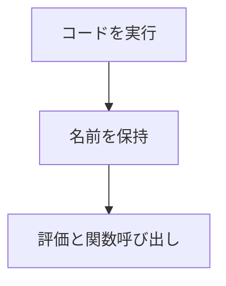

CPython を組み込み、文字列のコードの実行、式の評価（整数と浮動小数）、定義済みの関数を整数と浮動小数の引数で呼ぶところまでを提供しています。ゲームのオブジェクトを触れるようにするバインディングは、まだありません。

Python の開発用ランタイムが見つかったときだけ有効になり、無い環境では何もせず「使えない」と返します。

### 仕組み

実行したコードは共有の __main__ 名前空間に残ります。関数には整数と浮動小数の引数を渡し、整数の結果を受け取ります。呼び出し中は GIL を保持します。



### 実装

```cpp
// Engine/Scripting/Include/Nexus/Scripting/PythonHost.h
        // Executes a code string in the shared __main__ namespace (so functions/variables it
        // defines persist for later Eval/Call). Returns false and records LastError on a Python
        // exception.
        bool Exec(const char* code);

        // Evaluates an expression from __main__ globals to an integer / double.
        bool EvalI64(const char* expression, i64& out);
        bool EvalF64(const char* expression, f64& out);

        // Calls __main__.<funcName>(intArg, doubleArg) and returns its integer result. The
        // function must have been defined by a prior Exec.
        bool CallI64(const char* funcName, i64 intArg, f64 doubleArg, i64& out);
```
