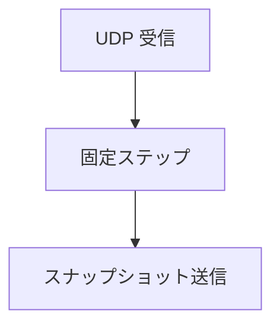

描画もウィンドウもない、ヘッドレスの権威サーバ（`NexusServer`）です。UDP のポート（既定 27015）で待ち受け、ワールドを 30 Hz の固定ステップで進めて、スナップショットをクライアントに送ります。最初のパケットを送ってきたクライアントは「準備待ち」で登録し、準備完了の合図が来るまで何も送りません。

中身は 6 個のエンティティが一定の速度で動くだけのデモで、クライアントからの入力の処理はまだありません。`--smoke` を付けると 120 ティックで終了するので、CI での動作確認に使えます。

### 仕組み

固定ステップは 1/30 秒で、--smoke の上限は 120 ティックです。以下は Ryzen 7 9800X3D / Radeon RX 9070、16 スレッドでの実行結果です。接続クライアントは 0 でした。



### 実装

```cpp
// Server/Src/Main.cpp
    constexpr nx::f64 kSimStepSeconds = 1.0 / 30.0;
    constexpr nx::f64 kMaxCatchupSeconds = 0.25;
    constexpr nx::f64 kMaxSleepSeconds = 0.002;
    constexpr int kMaxDatagramsPerLoop = 64;
    constexpr nx::u64 kSmokeTicks = 120;
```

### 実行結果

```text
[Info][LogServer] Headless server listening on UDP port 27015
[Info][LogServer] Smoke finished: 120 ticks in 4.004708 s, 0 client(s)
```
