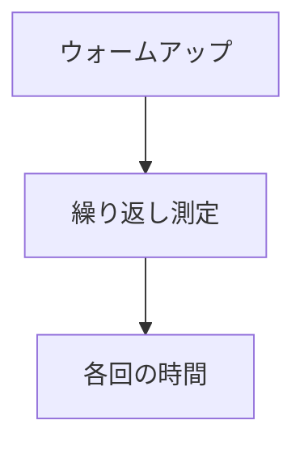

ジョブシステムの `ParallelFor` を測るマイクロベンチです。要素ごとに数十ナノ秒の計算（4x4 の行列の組み立て）を走らせ、粒度とワーカー数を振って、繰り返しの結果を 1 回ずつ全部出力します。平均で隠れて見えなくなる、実行ごとの二峰性を見るためです。

12 万インスタンスのシーンで不安定さが出たことから作りました。原因の候補だった Windows のタイマー分解能（既定 15.625 ms）を確かめるスイッチ（`--timer-res`）もありますが、これは診断用で、直し方ではありません。

### 仕組み

計測前にウォームアップを一度実行し、その後、各反復の経過時間を記録します。以下は Ryzen 7 9800X3D / Radeon RX 9070、16 スレッドの実行結果の一部です。



### 実装

```cpp
// Tools/JobBench/Main.cpp
        // One untimed warm-up so first-touch page faults and queue growth are not
        // charged to the first measured repetition.
        jobs.ParallelFor(count, grain, workload);

        std::vector<f64> samples;
        samples.reserve(static_cast<nx::usize>(reps));
        for (int rep = 0; rep < reps; ++rep)
        {
            const auto start = Clock::now();
            jobs.ParallelFor(count, grain, workload);
            samples.push_back(MillisecondsSince(start));
        }
```

### 実行結果

```text
system timer resolution: current 0.5000 ms (coarsest 15.6250, finest 0.5000)
hardware_concurrency: 16
count: 120000, reps: 10

[single-threaded] min 2.29  median 2.30  max 2.37 ms
      runs: 2.30 2.30 2.30 2.30 2.30 2.32 2.37 2.29 2.30 2.31

JobSystem workers: 15

grain      chunks     min      median   max     
128        938        0.27     0.55     1.09    
      runs: 0.28 0.56 0.55 0.71 0.27 0.70 0.46 0.37 1.09 0.31
256        469        0.27     0.39     0.58    
```
