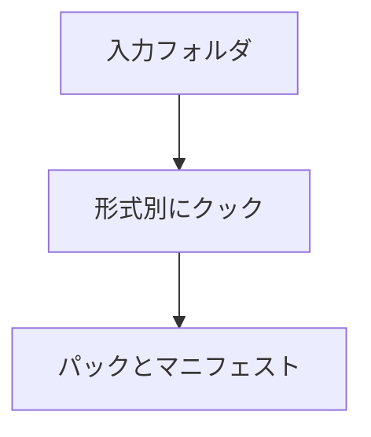

アセットのクッカーです。`--input` のフォルダを `--output` の `.nxpak` にまとめます。`--manifest` でマニフェストを書き出せ、`--force` で全件を作り直し、`--compress` で圧縮します。テクスチャ・メッシュ・マテリアル・フォントを実行時の形式に変え、それ以外のファイルはそのまま格納します。

### 仕組み

--mips と --texture-format でテクスチャの既定設定も指定できます。.nxmeta は設定用で、一般ファイルとは扱いが異なります。以下はヘルプを要求したときの出力です。



### 実装

```cpp
// Tools/Cook/Main.cpp
    void PrintUsage(FILE* stream)
    {
        std::fprintf(stream,
                     "Usage: NexusCook --input <dir> --output <file.nxpak> "
                     "[--manifest <file.json>] [--force] [--compress] [--verbose] "
                     "[--mips] [--texture-format <rgba8|bc1|bc3|bc5>]\n");
    }
```

### 実行結果

```text
NexusCook: unknown argument '--help'
Usage: NexusCook --input <dir> --output <file.nxpak> [--manifest <file.json>] [--force] [--compress] [--verbose] [--mips] [--texture-format <rgba8|bc1|bc3|bc5>]
```
