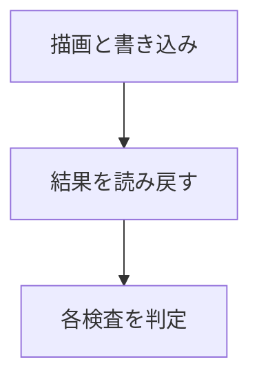

RHI を実機で確かめる自己診断です。コンピュートの書き込み、ストレージテクスチャ、3D テクスチャ、BGRA、パッチ領域の描画を、結果の画素を読み戻して判定し、最後に PASS か FAIL を出します。バックエンドごとに、`.spv` と `.dxil` のシェーダを読み分けます。

### 仕組み

判定は各検査の論理積です。以下は Ryzen 7 9800X3D / Radeon RX 9070 の Vulkan 実行結果です。



### 実装

```cpp
// Tools/RhiSelfTest/Main.cpp
    const bool passed = bindlessBufferReuse && storageWrite && storageSample && volume &&
                        volumeValidation && bgraReadback && patchRegion;
```

### 実行結果

```text
[Info][LogRHI] Vulkan inline ray query: enabled
[Info][LogRHI] Vulkan storage image write without format: enabled
[Info][LogRHI] Initialized Vulkan device: AMD Radeon RX 9070
[Info][LogApplication] RHI device created on: AMD Radeon RX 9070 (Vulkan)
[Info][LogRhiSelfTest] RHI self-test: bindlessBufferReuse=true finalReuseIndex=0 storageWrite=true storageSample=true volume=true volumeValidation=true bgraReadback=true patchRegion=true [PASS]
```
