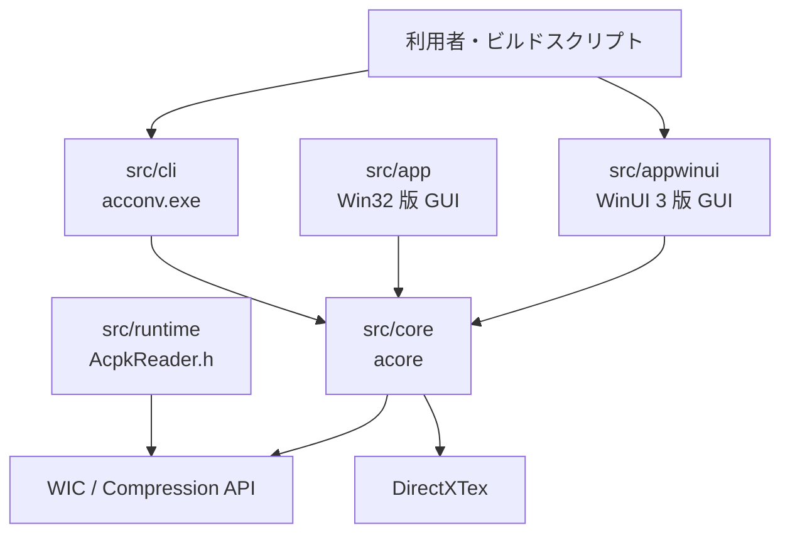
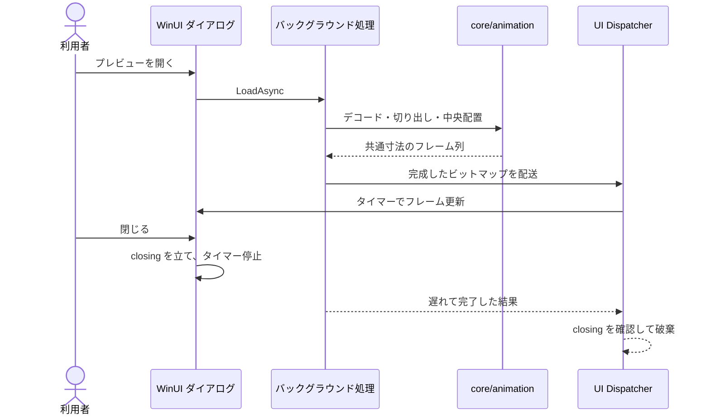

## 概要

ゲームで使う2D素材（画像・テクスチャ）の**軽量化・圧縮・変換**を行う Windows 専用の GUI ツールです。**Microsoft Store で公開しています。**

ファイルやフォルダをウィンドウにドラッグ&ドロップし、出力先のプリセットを選んで実行するだけで、画像をまとめて最適化します。フォルダに3Dモデルや音声が混ざっていても、それらは一覧に入りません。

| 種別 | 入力 | 出力 |
| --- | --- | --- |
| テクスチャ | PNG / JPEG / BMP / TIFF / GIF / HEIF / WebP / JPEG XR / TGA / DDS | PNG / JPEG / TGA / BMP / DDS・KTX2（BC1・BC3・BC4・BC5・BC7 + ミップマップ） |
| 汎用 | 任意のファイル・フォルダ | `.acpk` アーカイブ |

出力先のプリセット（汎用 / Unity 向け / Unreal 向け / 自作 DirectX 向け）を選ぶと、形式・最大サイズ・ミップの有無が自動で決まります。GUI と同じ処理系を叩くコンソール版も付属するので、ビルドスクリプトから回せます。

モジュールの構成です。GUI と CLI は同じ処理系を使い、読み出し側の参照実装はどこにも依存しません。



## 外部ライブラリをほとんど使わない

「外部ライブラリをできるだけ使いたくない」という方針で始めましたが、**自作するかどうかは学習価値ではなく、その機能がツールの目的にどれだけ近いかで決める**という基準にしました。このツールの価値は変換結果であって、コーデックの実装そのものではないからです。

一方でこのツールは Windows 専用と割り切れます。Windows は画像コーデックも汎用圧縮も OS の一部として提供しているので、「外部ライブラリ」の大半は「**OS の機能を呼ぶ**」に置き換えられます。

| 機能 | 使っているもの |
| --- | --- |
| 画像のデコード / エンコード / リサイズ | WIC（Windows 標準） |
| 汎用圧縮（XPRESS_HUFF / LZMS） | Compression API（Windows 標準） |
| BC7 圧縮 | DirectXTex（例外1） |
| GUI・ドラッグ&ドロップ | Windows App SDK / WinUI 3（例外2） |

外部依存はこの2件だけです。また Windows は **TGA のコーデックを持たず、DDS も BC7 を読めない**ので、この2つの読み込みは自前で書いています。

## 軽量化でやっていること

画像ごとの処理は内容に応じて切り替えます。

- アルファの有無を自動判定して **BC1 と BC7 を選び分ける**
- 法線マップを検出したら **BC5** にする
- 解像度をプリセットの上限にクランプし、ミップマップを生成する
- キューブマップとテクスチャ配列は面を保ったまま変換し、PNG など1面しか持てない形式へは十字や横一列に並べて出す

### 色を正しく扱う

縮小とミップ生成は**リニア空間**で行います。sRGB のバイトをそのまま平均すると暗くなるためです。4096 の白黒市松模様を 2048 に落とすと、平均輝度が 128 と 188 で食い違います。

さらに**半透明を含む画像は、フィルタ前にアルファで重み付け**します。透明部分はたいてい `(0, 0, 0, 0)` なので、そのまま平均すると黒が縁に滲みます。切り抜き・デカール・UIアトラスで出る、あの暗い縁取りの正体です。

法線マップは sRGB ではないので、どちらの変換もかけません。

縮小の前にリニアへ変換してアルファを掛け、縮小の後で元に戻している部分です。

```cpp
// src/core/image/TextureConverter.cpp
FloatPixel ReadPremultiplied(const ImageData& image, uint32_t x, uint32_t y, bool srgb) {
    const size_t at = (static_cast<size_t>(y) * image.width + x) * 4;
    const double alpha = static_cast<double>(image.pixels[at + 3]) / 255.0;
    const auto colour = [&](size_t channel) {
        const double encoded = static_cast<double>(image.pixels[at + channel]) / 255.0;
        return (srgb ? SrgbToLinear(encoded) : encoded) * alpha;
    };
    return FloatPixel{colour(0), colour(1), colour(2), alpha};
}
// ... Lanczos フィルタ処理 ...
const auto straight = [&](double premultiplied) {
    const double linear = std::clamp(premultiplied * inverseAlpha, 0.0, 1.0);
    return ToByte(srgb ? LinearToSrgb(linear) : linear);
};
```

### ファイルサイズと VRAM を分けて表示する

ここは実装していて一番はっきりさせる必要があった点です。

**BC 圧縮は GPU メモリを削るための仕組みであって、ディスク上のファイルを小さくするものではありません。** PNG はすでにエントロピー符号化されているので、DDS に変換するとファイルはむしろ大きくなるのが普通です。

```
2600x1800 の PNG   692 KB  →  DDS  3.0 MB    ファイルは +340%
           VRAM  23.8 MB  →      3.0 MB    VRAM は -87.5%
```

「軽量化ツール」でファイルが大きくなると、使う側は失敗したと受け取ります。そこで一覧には**「削減率」（ファイルサイズ）と「VRAM」を別々の列**で出し、何がどう変わったのかを取り違えないようにしました。

## アニメーションプレビュー

連番画像やスプライトシートを、**変換や分割出力を行う前に**指定した FPS で再生して確認できます。

<video src="/images/works/asset-converter-animation.mp4#t=0.1" controls loop muted playsinline preload="metadata" width="1920" height="1080"></video>

作るうえで判断が要ったのは次の3点です。

**並び順** — 連番はファイル名の数字を**数値として**比較します。文字列順だと `walk_10` が `walk_2` より前に来てしまうためです。

**寸法がばらつく連番** — フレームごとに大きさが違う場合は、最大幅 × 最大高の透明キャンバスに**中央揃え**で配置します。左上揃えだと、キャラクターの中心がフレームごとに動いてしまい、再生して確認する用途に合いません。

**UI を止めないこと** — デコード・切り出し・表示用フォーマットへの変換はすべてバックグラウンドで行い、UI スレッドへは完成したフレームだけを渡します。再生そのものはタイマーで回し、ダイアログを閉じたら止めます。遅れて完了した読み込みは、閉じたことを確認して捨てます。

処理の流れです。



拡大表示（1x / 2x / 4x / 8x）は補間を効かせず最近傍で作り直すので、ドット絵が滲みません。1フレームが 16 Mpx を超える倍率は拒否して、一時メモリが膨らまないようにしています。

## 複数のマスクを1枚にまとめる

別々のグレースケール画像を RGBA の各チャンネルに詰め込む機能です。4枚のマスクが1枚のテクスチャになるので、サンプリング回数もメモリも減らせます。


チャンネルごとに「どの画像の、どの成分を、反転するかしないか」を選べます。ファイル名の接尾辞（`_r` / `_g` / `_b` / `_a`、`_red` / `_green` …）がある場合は、**開いた時点で自動で割り当てた状態**にしてあります。手で4つ選び直す手間をなくすためです。

## .acpk — 1シークで任意のエントリへ

複数のアセットを1ファイルにまとめる機能では、独自形式の `.acpk` を定義しました。目的はゲーム実行時のロード高速化（シーク回数を減らすこと）です。

ZIP を採用すると deflate の実装か zlib の導入が必要になります。一方 Windows は Compression API で圧縮を提供しているので、**圧縮に外部ライブラリが要らないなら、形式側もランタイムから読みやすい単純なものを自作したほうがよい**と考えました。

設計方針は「ランタイムがヘッダと TOC だけ読めば、任意のエントリへ1シークで到達できること」です。TOC は1件48バイトの固定長で、パスはハッシュで引きます。

ヘッダと TOC の1件分の定義です。サイズは `static_assert` で固定しています。

```cpp
// src/runtime/AcpkReader.h
#pragma pack(push, 1)
struct Header {
    uint32_t magic;
    uint32_t version;
    uint32_t flags;
    uint32_t entryCount;
    uint64_t tocOffset;
    uint64_t stringOffset;
};
struct EntryRecord {
    uint64_t pathHash;
    uint32_t pathOffset;
    uint32_t pathLength;
    uint64_t dataOffset;
    uint64_t rawSize;
    uint64_t compressedSize;
    uint16_t algorithm;
    uint16_t reserved;
    uint32_t crc32;
};
#pragma pack(pop)
static_assert(sizeof(Header) == 32);
static_assert(sizeof(EntryRecord) == 48);
```

すでに圧縮済みのエントリ（PNG や BC 圧縮済みの DDS）は、自動で無圧縮格納に落とします。二重に圧縮しても縮まないためです。圧縮方式は XPRESS_HUFF（高速）と LZMS（約25%小さい代わりに30倍遅い）から選べます。

読み出し側の参照実装も用意しました。**このツールのビルドにも処理系にも依存しない単一ヘッダ**なので、ファイルごとコピーすれば使えます。必要なのは `<windows.h>` と `Cabinet.lib` だけです。

## 現場で引っかかる所を潰す

作っていて一番時間を使ったのは、変換そのものではなく**「なぜか動かない」をなくす**ことでした。

**TGA のアルファ** — TGA のヘッダには「1ピクセルあたりの属性ビット数」があり、**32bit で 0 と宣言しているファイルは BGRX** で、4バイト目はアルファではありません。これを無視して4バイト目をアルファとして読むと、多くのファイルで画像全体が透明になります。宣言に従って読み、無視した4バイト目が 255 以外だったときだけログに出します。

属性ビットを見てアルファの扱いを決めている部分です。

```cpp
// src/core/image/WicIO.cpp
// Bits 0-3 are the attribute bits per pixel. A 32-bit file that declares 0 of them is BGRX:
// the fourth byte carries nothing.
const bool hasAlphaChannel =
    bytesPerPixel == 4 && (descriptor & 0x0F) != 0;
// ...
out[0] = pixel[2];
out[1] = pixel[1];
out[2] = pixel[0];
out[3] = hasAlphaChannel ? pixel[3] : 255;

if (bytesPerPixel == 4 && !hasAlphaChannel && pixel[3] != 255) {
    discardedSomething = true;
}
```

**アセットではないファイル** — 0バイトのファイルと Git LFS のポインタは、変換に渡す前に弾いて理由を出します。どちらもゲームのリポジトリでは日常的に出てきます（中断したダウンロード、`git lfs pull` 前のクローン）。そのままデコーダに渡すと WIC は「コンポーネントが見つかりません」と答えます。事実ではないうえ、コーデックを探しに行かせてしまいます。

変換の前に、空のファイルと LFS のポインタを判別している部分です。

```cpp
// src/core/Convert.cpp
const auto size = std::filesystem::file_size(path, ec);
if (ec) {
    return {};
}
if (size == 0) {
    return "ファイルが空です (0 バイト)。ダウンロードや書き出しが中断した可能性があります";
}
if (size > 1024) {
    return {};
}

std::ifstream file(path, std::ios::binary);
std::array<char, 64> head{};
file.read(head.data(), static_cast<std::streamsize>(head.size()));
const std::string_view prefix(head.data(), static_cast<size_t>(file.gcount()));
if (prefix.starts_with("version https://git-lfs.github.com/spec/")) {
    return "Git LFS のポインタファイルです。`git lfs pull` で実体を取得してください";
}
```

**読み取り専用のファイルは消さない** — 「元ファイルを置換」で拡張子が変わる場合は元を削除しますが、読み取り専用のものは残します。Perforce や OneDrive はチェックアウトするまでアセットを読み取り専用にするので、これを「触るな」の明示的な印として扱っています。

**長いパス** — 260文字を超えるパスに対応していますが、Windows 側のレジストリ設定にも依存します。アプリ側からは変更できないので、その場合は「パスが N 文字あります」とログに出して原因が分かるようにしました。

いずれも、**エラーメッセージが嘘をつかないこと**を基準にしています。

## 対象を2D素材だけに絞った

もともとはテクスチャ・3Dモデル・音声・汎用ファイルの4種類すべてを扱う設計で、一度は4種類とも実装し終えました。そのうえで、**3Dモデルと音声を対象から外しました。**

実際に使う側から見ると、広さが利点になっていなかったためです。

- 使わないのに保守が要る（3D関連だけでテストと専用の検査を抱えていた）
- 使わないのに設定画面を占める（オプションの半分以上が担当外のスイッチだった）
- 使わないのにビルドが重い（FBXパーサのビルドが初回構成の10〜15分のほぼ全部だった）
- **フォルダを落としたときに誤爆する**（画像の隣にあるモデルや音声まで一覧に入って変換された）

機能を増やすより、担当範囲だけを持つ道具のほうが扱いやすい、というのがこの判断の根拠です。実装済みの機能を消す判断は、作ったものへの愛着があるぶん一番迷いました。
