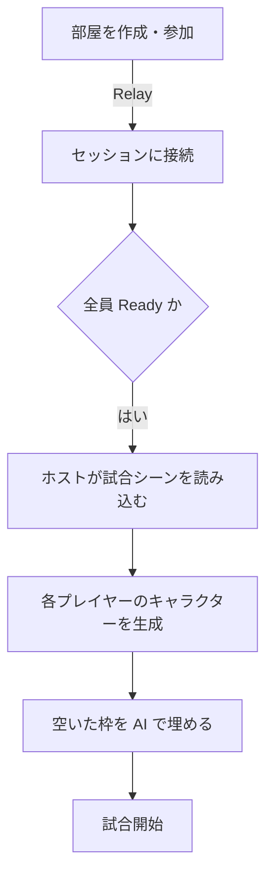
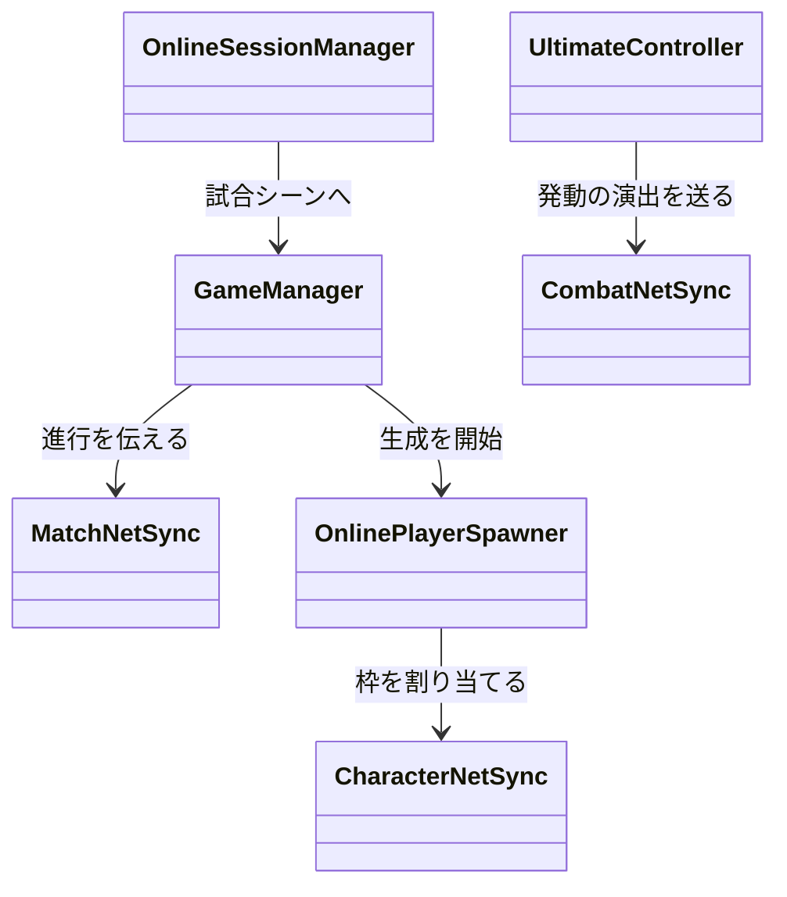

## 概要

3対3のサッカーと三人称シューターを組み合わせた対戦ゲームです。撃って相手を倒すだけでなく、ボールを撃って押し出し、ゴールを狙います。キャラクターごとにスキルと、溜めて使う必殺技（ULT）があります。オフラインの AI 戦と、最大6人のオンライン対戦があります。

オンライン対戦が始まるまでの流れです。



## 担当1：スキルと ULT

ULT は、キャラクターの定義が持つ ULT のデータを、キャラクターに付いた `UltimateController` が実行する形にしています。ULT ごとの数値はデータ（ScriptableObject）に、処理は ULT ごとの実行クラスに分けています。

ゲージは、時間の経過、相手に与えたダメージ、撃破、ボールに当てたとき、味方のゴールで溜まります。実装した ULT は次の6種類です。

- 一定時間、武器を火炎弾に変える
- 溜めた「響き」を消費して回復し続ける
- 周期的に咆哮し、敵を封印して味方を強化する
- 狙った場所に壁を置く（もう一度押すと壊す）
- 敵へのダメージ・味方の回復・ボールの押し出しを同時に行うビーム
- 敵やボールを吹き飛ばす溜めキック

発動してよい状態かを確かめている部分です。操作しているのが自分の端末か、倒れていないか、ゴール演出中でないかを見てから実行します。

```csharp
// Assets/Scripts/UltimateController.cs
public bool TryActivate()
{
    if (!CharacterNetSync.IsControlledHere(gameObject))
        return false;

    UltimateAction ultimate = Ultimate;
    if (ultimate == null)
        return false;

    if (_health != null && _health.IsDead)
        return false;

    if (_gameManager != null && _gameManager.IsGameplayLocked)
        return false;

    if (ultimate.TryHandlePress(_shot))
        return true;

    // ...
}
```

## 担当2：ネットワーク

Unity Gaming Services のセッションと Relay で部屋をつなぎ、Netcode for GameObjects で同期しています。専用サーバーは使わず、部屋を作った人がホストになります。

- 準備完了（Ready）は、セッションのプレイヤー情報として持たせています
- 試合の進行（キックオフ、得点、残り時間、試合終了）はホストが決め、`MatchNetSync` が各端末へ伝えます
- ダメージは、撃った側の端末がホストに申告し、ホストが送り主・倒れていないか・試合中か・相手のチームなどを確かめてから体力に反映します
- 空いている枠や、途中で抜けたプレイヤーの枠は AI が引き継ぎます



全員が準備完了したら、ホストが試合のシーンを読み込みます。

```csharp
// Assets/Scripts/Online/OnlineSessionManager.cs
public bool CanStartMatch()
{
    return IsHost && CurrentSession.Players.Count >= 2 &&
           CurrentSession.Players.All(IsReady);
}

public void StartMatch()
{
    // ...
    if (_matchStarted || !CanStartMatch())
        return;

    if (NetworkManager.Singleton == null || !NetworkManager.Singleton.IsServer)
    {
        ReportError("NetworkManager が Host として起動していません。", null);
        return;
    }

    _matchStarted = true;
    NetworkManager.Singleton.SceneManager.LoadScene(SceneNames.Game, LoadSceneMode.Single);
    // ...
}
```
