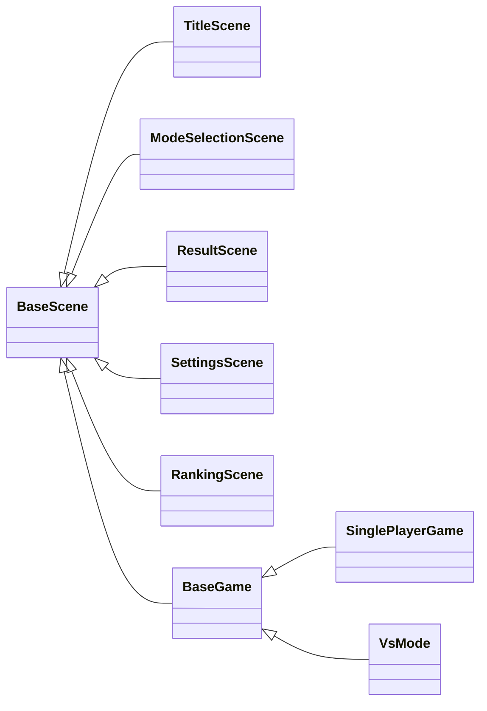
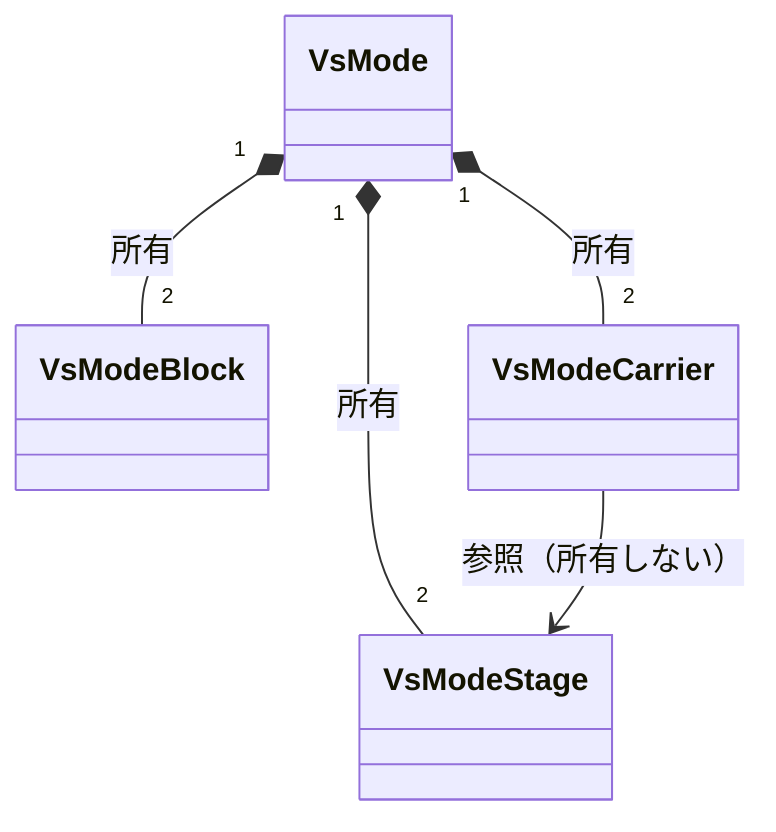

## 概要

同じ色のジェムを4つつなげると消すことができ、**連鎖**させることもできます。ジェムが溢れてしまうとゲームオーバーです。

DirectX 11 を初めて使って制作した2Dゲームで、制作期間は2週間でした。

## 技術的に取り組んだこと

### 工夫点1 — シーン生成を CreateScene に一本化

シーンの生成を `CreateScene` に一本化し、スマートポインタを使って安全に管理しています。

生成の窓口になっている関数です。

```cpp
// src/scene/scene.cpp
static std::unique_ptr<BaseScene> g_CurrentScene;

static std::unique_ptr<BaseScene> CreateScene(SCENE scene)
{
    switch (scene)
    {
    case SCENE_TITLE:          return std::make_unique<TitleScene>();
    case SCENE_MODE_SELECTION: return std::make_unique<ModeSelectionScene>();
    case SCENE_GAME:           return std::make_unique<SinglePlayerGame>();
    case SCENE_VS_MODE: {
        auto vs = std::make_unique<VsMode>();
        SetVsModeInstance(vs.get());
        return vs;
    }
    case SCENE_RESULT:         return std::make_unique<ResultScene>();
    case SCENE_SETTINGS:       return std::make_unique<SettingsScene>();
    case SCENE_RANKING:        return std::make_unique<RankingScene>();
    default:                   return nullptr;
    }
}
```

すべてのシーンが `BaseScene` を継承しているので、同じ型で生成して `g_CurrentScene` ひとつで持てます。



もとは関数ポインタの配列でシーンを切り替えていて、対戦モードだけ専用のラッパーが寿命を管理していました。シーンによって持ち主が違う状態をやめ、すべてのシーンを同じ型で生成して一か所で持つ形に揃えました。

### 工夫点2 — プレイヤーごとに独立したオブジェクトを管理

対戦モードでは `unique_ptr` を用いて、2人のプレイヤーそれぞれに独立したオブジェクトを持たせています。

対戦モードが持つメンバーと、Carrier に Stage を渡している箇所です。

```cpp
// src/scene/VsMode.h
std::unique_ptr<VsModeBlock>   m_Block1;
std::unique_ptr<VsModeBlock>   m_Block2;
std::unique_ptr<VsModeCarrier> m_Carrier1;
std::unique_ptr<VsModeCarrier> m_Carrier2;
std::unique_ptr<VsModeStage>   m_Stage1;
std::unique_ptr<VsModeStage>   m_Stage2;

// src/scene/VsMode.cpp
m_Carrier1->SetStage(m_Stage1.get());
// ...
m_Carrier2->SetStage(m_Stage2.get());
```

`VsMode` が6つすべてを所有し、`VsModeCarrier` は対応する `VsModeStage` を所有せずに参照します。



最初は6つとも new / delete で管理していましたが、unique_ptr に置き換えました。所有するのは VsMode だけで、各プレイヤーの部品同士は所有権を持たないポインタで参照しています。誰が解放するかが一目で分かるので、解放の順番や書き忘れを気にする必要がなくなりました。

## 振り返り

今なら、1P と 2P で別々に並んでいる変数を、プレイヤー単位の構造にまとめます。同じ処理を2回書かずに済み、人数が変わっても対応できます。
