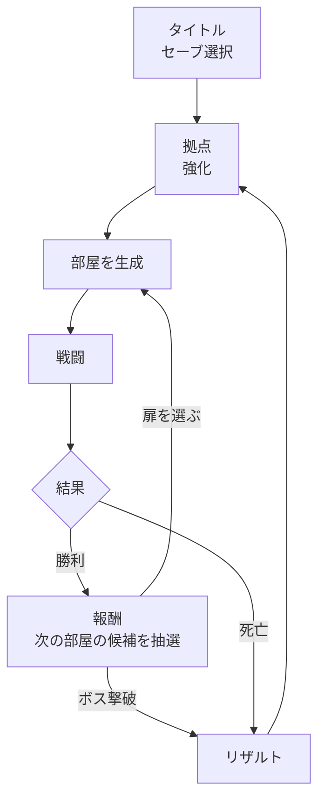
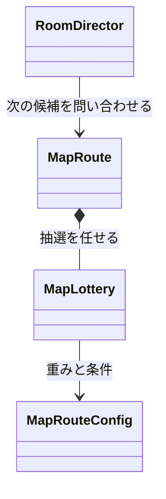

## 概要

左右の手に別々の銃を持って戦う、見下ろし視点のローグライト・アクションです。拠点で強化してから出撃し、全7部屋の「ラン」に挑みます。部屋をクリアするたびに次の部屋の候補が扉として現れ、どこへ進むかをプレイヤーが選びます。

ゲームの流れです。



## 担当：マップ生成アルゴリズム

次の部屋としてどの種類を出すかの抽選と、ランの進行状態の管理を担当しました。部屋の生成や戦闘を進める `RoomDirector` から、次の候補を問い合わせられる形になっています。



### 抽選の決まりごと

- 部屋の種類ごとに重みを付けて抽選します
- 一度選んだ種類は候補から外すので、並んだ扉に同じ種類が重なりません
- 特定の部屋は「このマップまでに何回」と出現を保証します。残りのマップ数で出しても足りるうちは確率に任せ、ぎりぎりになったら確定で入れます
- ボスが選ばれたら、扉はボスの部屋だけにします
- 一度出た部屋をもう出さない種類は、抽選の履歴を見て外します

出現の保証と、重み付き抽選の部分です。

```csharp
// Assets/_Project/Scripts/Runtime/Map/MapLottery.cs
// 注②: 残りのマップ全部で出しても足りるかぎりは確率に任せ、ぎりぎりになったら固定で入れる
RoomKind guaranteed = _config.GuaranteedKind;
if (mapNumber <= _config.GuaranteedByMap && GuaranteedShown < _config.GuaranteedCount)
{
    int mapsLeft = _config.GuaranteedByMap - mapNumber + 1;
    if (_config.GuaranteedCount - GuaranteedShown >= mapsLeft)
    {
        result.Add(guaranteed);
        _candidates.Remove(guaranteed);
    }
}

while (result.Count < _config.ChoiceCount && _candidates.Count > 0)
{
    RoomKind picked = PickWeighted(mapNumber);
    _candidates.Remove(picked);

    if (picked == RoomKind.Boss)
    {
        result.Clear();
        result.Add(RoomKind.Boss);
        break;
    }

    result.Add(picked);
    // ...
}
```

### 一度決めた候補は引き直さない

候補は1つのマップにつき一度だけ抽選し、同じマップの中では何度問い合わせても同じ結果を返します。部屋を読み込み直したり、中断したところから再開したりしても、扉の行き先が変わらないようにするためです。扉に入るときも、今の候補にない種類なら受け付けません。

```csharp
// Assets/_Project/Scripts/Runtime/Map/MapRoute.cs
public static IReadOnlyList<RoomKind> NextChoices()
{
    if (!IsRunning || IsLastMap)
    {
        return System.Array.Empty<RoomKind>();
    }

    if (_choices == null)
    {
        _choices = _lottery.Draw(CurrentMap + 1);
    }

    return _choices;
}

public static bool Enter(RoomKind kind)
{
    if (_choices == null || !_choices.Contains(kind))
    {
        // ...
        return false;
    }

    _choices = null;
    CurrentMap++;
    // ...
}
```
