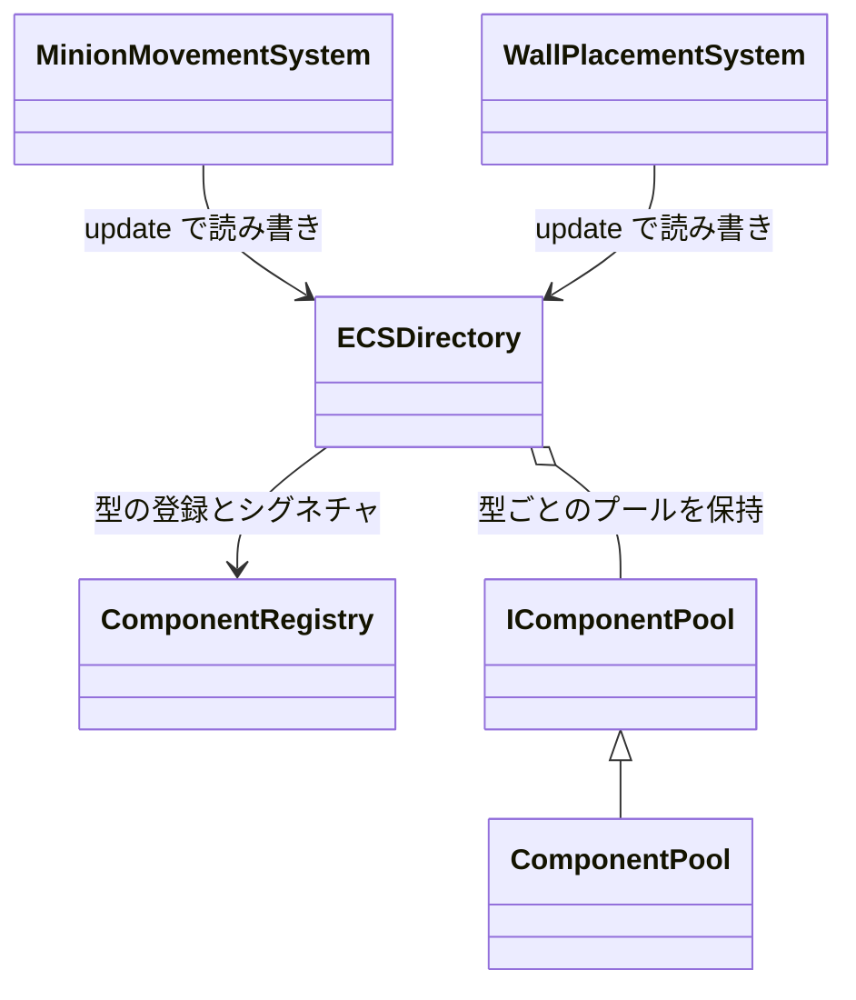
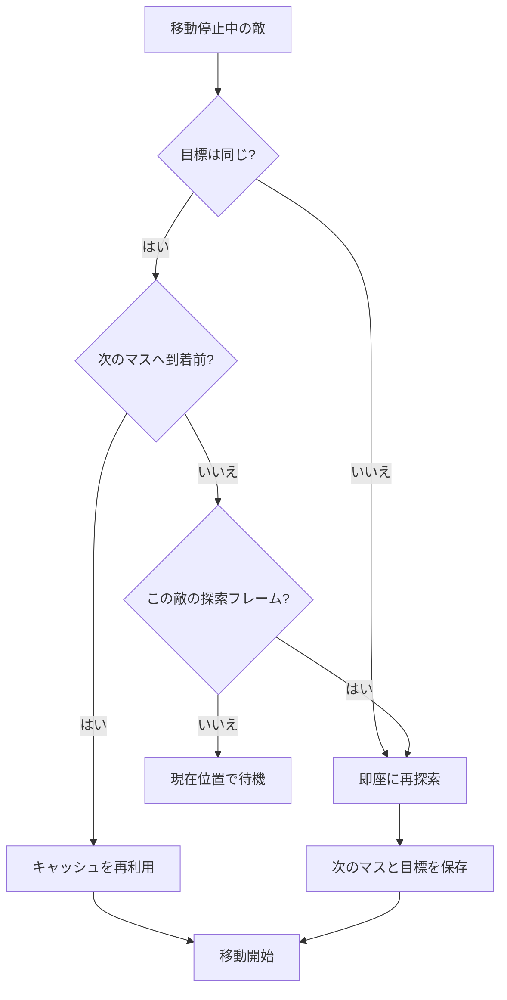

## 概要

初めてのチーム制作で作ったタワーディフェンスゲームです。**大量の敵を同時に出しても動作が重くならないこと**を軸に据えて設計しました。

チーム構成は、プログラマー6人・プランナー2人・デザイナー3人の計11人です。

2年次の進級制作展（HAL EVENT WEEK）で、**ビジュアル賞**を受賞しました。

## 自分が担当した部分

メインプログラマーとして、**フレームワーク・経路探索・描画系**を主に担当しました。

### フレームワーク — ECS の採用

タワーディフェンスは敵・味方・弾・エフェクトと、大量の要素を同時に管理する必要があります。そのため ECS を採用し、エンティティ管理・コンポーネントプール・コンポーネント登録まわりを実装しました。

システムはカテゴリごとにディレクトリを分けています（AI / Animation / Combat / Effects / Movement / Pathfinding / Placement / Rendering / Waves など）。

機能が増えた段階で、システムを用途別のフォルダに整理し直し、肥大化したコンポーネントも分割しました。変更が他のメンバーの担当に波及しにくくするためです。

データの持ち方と、システムからの使い方の関係です。



### 経路探索 — A* と、経路の再利用

グリッド上の A* を実装しました。ヒューリスティックはマンハッタン距離です。

大量の敵が同時に経路を求めるため、**そもそも A* を呼ばずに済ませること**を優先しました。

**1. 経路のキャッシュ**

各敵が「どのゴールに対して計算したか」と「次の一歩」を保持します。ゴールが変わっておらず、まだ次の一歩に到達していなければ、キャッシュをそのまま使って探索を行いません。

**2. 再計算のフレーム分散**

再計算が必要な場合も、敵ごとにフレームをずらして実行します。1フレームに走る探索の数を抑えるためです。

ただし**ターゲットが変わったときは分散を無視して即座に再計算**します。古いキャッシュで間違った方向に進ませないためです。壁が破壊・設置されたときも、キャッシュを無効化します。

移動が止まった敵が次の一歩を決めるときの判定です。



**3. 探索そのものの軽量化**

- A* の作業用コンテナを使い回す構造にし、呼び出しごとのヒープ確保をなくしました
- 壁はグリッドのハッシュマップに同期しておき、ECS を走査せずに障害物判定ができるようにしました

使い回している作業用コンテナです。

```cpp
// src/Core/Systems/Pathfinding/Pathfinding.h
struct PathfinderContext {
    std::priority_queue<Node, std::vector<Node>, std::greater<Node>> openList;
    std::unordered_set<GridCoord, GridCoordHash> closedSet;
    std::unordered_map<GridCoord, float, GridCoordHash> gCostMap;
    std::unordered_map<GridCoord, GridCoord, GridCoordHash> parentMap;
    std::vector<GridCoord> pathBuffer;
    // ...
};
```

なお、経路探索をワーカースレッドで回す仕組みは、チームの別のメンバーが担当しています。

### 描画系

**DDS（BC7）連番による2Dアニメーション**

2Dアニメーションを PNG の連番ではなく、BC7 で圧縮した DDS の連番で持つようにしました。変換はバッチスクリプトにしてあります。

GPU が圧縮されたまま扱える形式なので、**実行中のメモリ使用量が下がり、読み込み時のデコードも不要になります**。アニメーション枚数が多いほど効きます。

**シェーダーによる効果範囲描画**

スキルの効果範囲や防衛ラインの表示を、専用のシェーダーで描いています。ワールド座標の X + Z から45度の斜線を生成し、位相を時間で進めることでストライプが流れて見えます。

```hlsl
// ワールド座標から斜線ストライプを作り、位相をずらして流す
float stripeValue = (i.worldPos.x + i.worldPos.z) / stripeWidth + stripePhase;
float pattern     = frac(stripeValue);

// 境界を柔らかくしてジャギーを消す
float edge  = abs(pattern - 0.5f) * 4.0f;
float alpha = 1.0f - smoothstep(0.3f, 0.5f, edge);
```

色は定数バッファから渡しているので、同じシェーダーで NPC の射程（水色）と防衛ライン（赤）を描き分けています。

**掴んだNPCの振り子描画**

カードから NPC をフィールドにドラッグするとき、つままれた NPC が揺れます。上辺の中央を支点として角度と角速度を持たせ、マウスの移動量を角速度に加えることで、引っぱられて振り子のようにぐらつく動きにしました。

角度と角速度を更新している部分です。

```cpp
// src/Graphics/UI/Gameplay/CardUI.cpp
m_pinchAngleVel +=
    (io.MousePos.x - m_prevMousePosForPinch.x) * PINCH_SENSITIVITY;
m_pinchAngle += m_pinchAngleVel;
m_pinchAngleVel *= PINCH_VEL_DAMPING;
m_pinchAngle *= PINCH_ANGLE_DAMPING;
// ...
const float c = std::cos(m_pinchAngle);
const float s = std::sin(m_pinchAngle);
```

## 詰まった点と解決

壁を置けるタワーディフェンスなので、置き方次第で敵の通り道が完全に塞がります。壁を置く前に、仮に置いた状態でゴールまでの経路が残るかを確かめ、結果はマスごとにキャッシュしています。

仮の壁を足した状態で経路を探している部分です。

```cpp
// src/Core/Systems/Placement/WallPlacementSystem.cpp
std::vector<Pathfinding::GridCoord> path;
constexpr int maxIterations =
    GameConstants::Rendering::Pathfinding::QUICK_CHECK_ITERATIONS;
const auto* obstacles = &pendingObstacles;
bool pathExists = Pathfinding::findPath(
    ecs, startCoord, goalCoord, path, maxIterations, obstacles);
// ...
```
