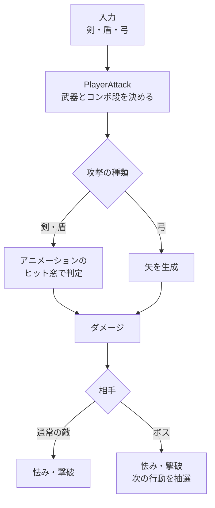
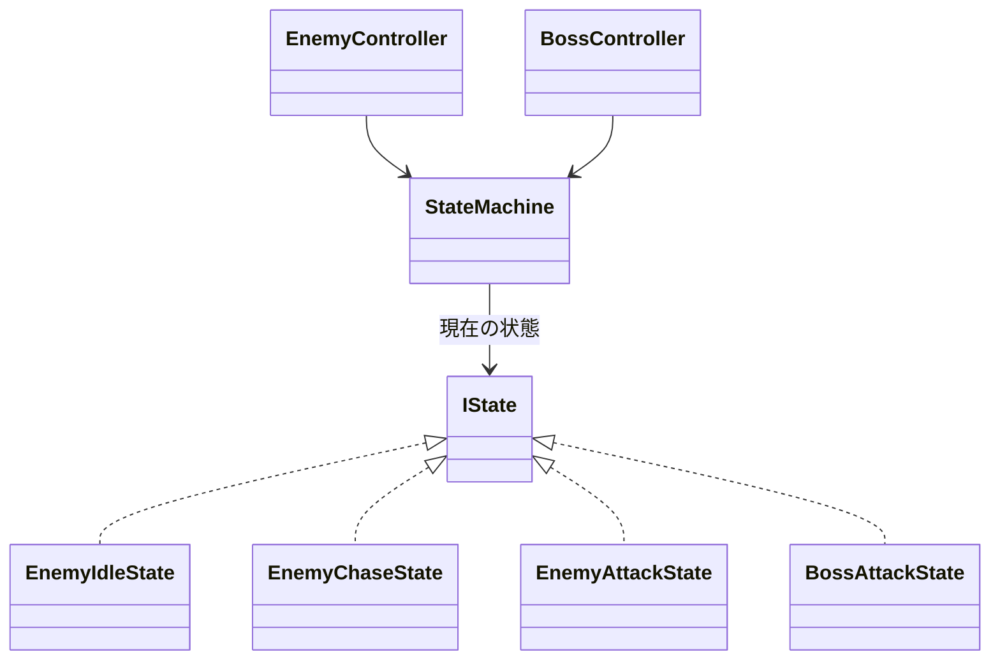

## 概要

剣・盾・弓の3種類の武器をその場で切り替えながら戦う、三人称視点の3Dアクションです。雑魚敵を倒しながら進み、ステージの最奥にいるボスの撃破を目指します。ロックオン、コンボ、ガード、回避、カウンター、必殺攻撃があります。

<video src="/images/works/trigear-play.mp4#t=0.1" poster="/images/works/trigear-play.webp" controls loop muted playsinline preload="metadata" width="1280" height="720"></video>

戦闘全体の流れです。



## 担当：メインプログラマー

### 3つの武器をまたぐコンボ

同じ武器を続けて押すと1段目から3段目へつながり、コンボの途中で別の武器に持ち替えると、武器の組み合わせごとの専用の攻撃に派生します。武器ごとの攻撃データと、武器間の派生のデータは分けて持っています。

攻撃の入力を受けて、派生かコンボの何段目かを決めている部分です。

```csharp
// Assets/Script/Player/PlayerAttack.cs
private void ProcessWeaponAttackInput(bool grounded, float now)
{
    if (!TryGetPressedWeaponType(out var weapon))
        return;

    if (_groundComboJustEnded || _groundComboEndCooldownTimer > 0f)
        return;

    if (!grounded)
        return;

    _weaponChange?.SetEquipped(weapon);
    // ...

    if (TryProcessWeaponPairGroundTransition(weapon, now, logPrefix))
    {
        // ...
        return;
    }

    if (now - _animComboState.GetLastGroundAttackTime(weapon) > comboResetDelay)
        _animComboState.ResetGroundComboIndex(weapon);

    var gIdx = _animComboState.GetGroundComboIndex(weapon);
    var stage = gIdx + 1;
    PlayGroundAttackAnimation(stage);
    _animComboState.SetGroundComboIndex(weapon, (gIdx + 1) % 3);
    // ...
}
```

剣と盾の当たり判定は、アニメーションのうち攻撃が当たってよい区間だけで行い、同じ相手に同じ攻撃が二重に当たらないようにしています。

### 敵とボスで共有する状態マシン

状態マシンは「入る・毎フレーム・出る」の3つだけを持つ軽い作りにして、通常の敵とボスで同じものを使っています。



通常の敵は「待機 → 追跡 → 攻撃」を繰り返し、攻撃を受けると怯み、体力がなくなると撃破されます。追跡中に、探知範囲から外れたか、攻撃範囲に入ったかを見ている部分です。

```csharp
// Assets/Script/Enemy/States/EnemyChaseState.cs
var offset = targetPos - _owner.transform.position;
var distSqr = offset.sqrMagnitude;

// 探知範囲外に出たら Idle へ戻る
if (distSqr > detectionRangeSqr)
{
    _owner.StateMachine.ChangeState(_owner.IdleState);
    return;
}

// 攻撃範囲内かつクールダウン完了で Attack へ
if (distSqr <= attackRangeSqr && _owner.CanAttack)
{
    _owner.StateMachine.ChangeState(_owner.AttackState);
    return;
}
```

### ボスの行動の抽選

ボスは、プレイヤーとの距離が近い・中くらい・遠いかで候補の行動を絞り、設定した重みで次の行動を抽選します。攻撃はそれぞれ独立した部品になっていて、予兆、当たり判定、演出、次に使えるまでの待ち時間を、その部品の中で管理しています。
